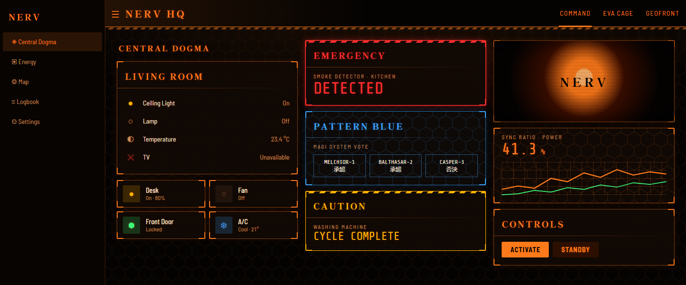

# NERV MAGI — Home Assistant theme

[](https://github.com/hacs/integration)
[](https://github.com/CPetrevski/ha-nerv-magi-theme/actions/workflows/validate.yml)
[](https://github.com/CPetrevski/ha-nerv-magi-theme/releases)

A dark Home Assistant theme modelled on the NERV command-centre consoles from *Neon Genesis Evangelion*: black glass, hairline orange vector frames, hexagon grids, phosphor glow, red hazard alerts and "Pattern Blue" readouts.

[](https://my.home-assistant.io/redirect/hacs_repository/?owner=CPetrevski&repository=ha-nerv-magi-theme&category=theme)



## Contents

- [Features](#features)
- [Requirements](#requirements)
- [Installation](#installation)
- [Apply the theme](#apply-the-theme)
- [Turn on the console effects (card-mod)](#turn-on-the-console-effects-card-mod)
- [Add the fonts](#add-the-fonts)
- [Card classes](#card-classes)
- [Example cards](#example-cards)
- [Example dashboard](#example-dashboard)
- [Customising](#customising)
- [Troubleshooting](#troubleshooting)

## Features

- **Works out of the box.** Orange-on-black palette, hexagon-grid dashboard background, sharp corners, and orange buttons, toggles and sliders (not the default Home Assistant blue).
- **Console effects with card-mod.** Orange corner brackets, faint scanlines and a boot flicker on every card, plus a hazard-striped header bar that turns red in edit mode.
- **Card classes.** Mark any card as `alert`, `caution`, `pattern-blue`, `magi`, `crt` or `plain`.
- **Evangelion typography.** Optional fonts for the serif title-card headings and terminal-style numbers.
- **Chart colours.** Graph lines use the NERV palette: orange, green, blue, red, amber and purple.
- ***Add GIFS*** [gifs](https://github.com/custom-cards/button-card) Add GIFS inside the dash.
- **Reduced motion.** Animations stop if your device has "reduce motion" turned on.

## Requirements

| What | Needed? | Why |
|---|---|---|
| Home Assistant 2025.x or newer | Recommended | Older versions work, but some buttons and toggles may stay blue |
| [HACS](https://hacs.xyz) | Recommended | Easiest way to install and update the theme |
| [card-mod](https://github.com/thomasloven/lovelace-card-mod) | Optional | Console effects and card classes |
| [button-card](https://github.com/custom-cards/button-card) | Optional | Only for the example switch, scene and server cards |

## Installation

### Option A: HACS (recommended)

**One click:** select this button, then select **Open link** and **Download** in Home Assistant. Then skip to step 5.

[](https://my.home-assistant.io/redirect/hacs_repository/?owner=CPetrevski&repository=ha-nerv-magi-theme&category=theme)

**Or add it by hand:**

1. In Home Assistant, open **HACS**.
2. Select the **three dots** (top right) → **Custom repositories**.
3. Paste `https://github.com/CPetrevski/ha-nerv-magi-theme`, set **Type** to **Theme**, then select **Add**.
4. Search HACS for **NERV MAGI**, open it and select **Download**.
5. Make sure themes are turned on (see [Turn on the themes folder](#turn-on-the-themes-folder)).
6. Go to **Developer tools** → **Actions**, run **`frontend.reload_themes`** (Home Assistant Frontend: Reload themes).

### Option B: Manual

1. Download [`themes/nerv_magi.yaml`](themes/nerv_magi.yaml).
2. Copy it into your Home Assistant `config/themes/` folder (create the folder if needed). The File editor or Studio Code Server add-ons make this easy.
3. Make sure themes are turned on (next section).
4. Run **`frontend.reload_themes`** from **Developer tools** → **Actions**.

### Turn on the themes folder

Skip this if you already use other themes. Otherwise add this to `configuration.yaml`, then restart Home Assistant:

```yaml
frontend:
  themes: !include_dir_merge_named themes
```

> If you already have a `frontend:` section, add the `themes:` line inside it rather than adding a second `frontend:`.

## Apply the theme

There are three ways to use it. Pick whichever suits you.

**Just for you (this browser or device)**

1. Select your name at the bottom of the sidebar to open your **Profile**.
2. Under **Browser settings** → **Theme**, choose **NERV MAGI**.

**For one dashboard view (everyone who opens it)**

1. Open the dashboard and select the **pencil** (Edit dashboard).
2. Select the **pencil next to the view's name** (tab).
3. Set **Theme** to **NERV MAGI** and save.

In YAML this is one line on the view:

```yaml
views:
  - title: Home
    theme: NERV MAGI
```

**As the default for everyone**

Go to **Developer tools** → **Actions**, switch to YAML mode and run:

```yaml
action: frontend.set_theme
data:
  name: NERV MAGI
```

> NERV MAGI is a dark-only theme, so it always shows in dark mode.

## Turn on the console effects (card-mod)

The theme works without card-mod. Installing card-mod adds the corner brackets, scanlines, boot flicker, striped header and the [card classes](#card-classes).

1. In **HACS**, search for **card-mod** and select **Download**.
2. Reload your browser (on desktop, <kbd>Ctrl</kbd> + <kbd>F5</kbd>; in the mobile app, **Settings** → **Companion app** → **Debugging** → **Reset frontend cache**).

The effects turn on by themselves for every dashboard using NERV MAGI. No other setup is needed.

**Recommended:** for the effects to load reliably (especially the header stripe), also load card-mod as a frontend module. Add this to `configuration.yaml` and restart:

```yaml
frontend:
  themes: !include_dir_merge_named themes
  extra_module_url:
    - /hacsfiles/lovelace-card-mod/card-mod.js
```

## Add the fonts

Optional. Without them the theme falls back to standard system fonts.

1. Turn on **Advanced mode** in your **Profile** if you haven't already.
2. Go to **Settings** → **Dashboards** → **three dots** (top right) → **Resources** → **Add resource**.
3. Paste this URL and set **Resource type** to **Stylesheet**:

   ```
   https://fonts.googleapis.com/css2?family=Barlow+Semi+Condensed:wght@400;500;700&family=Share+Tech+Mono&family=Shippori+Mincho+B1:wght@800&display=swap
   ```

4. Reload your browser.

| Font | Used for |
|---|---|
| Shippori Mincho B1 | Headings (stands in for Matisse EB, the Evangelion title-card typeface) |
| Barlow Semi Condensed | Body text |
| Share Tech Mono | Numbers, codes and readouts |

## Card classes

With card-mod installed, give any card one or more classes to change its look. Combine classes with spaces, e.g. `class: magi pattern-blue`.

| Class | Look | Good for |
|---|---|---|
| `alert` | Red frame, hazard stripe, pulsing red glow | Alarms, open doors, leaks |
| `caution` | Amber frame and hazard stripe | Warnings, low batteries |
| `pattern-blue` | Blue "Angel detected" palette | Water, humidity, network |
| `magi` | Hexagon-grid panel | Graphs, status summaries |
| `crt` | Scanline and vignette overlay on top | GIFs, pictures, cameras |
| `plain` | Removes the console effects | Cards that look busy with them |

### Adding a class in the visual editor

1. Edit the dashboard and open the card.
2. Select **Show code editor** (bottom left of the card editor).
3. Add these lines at the end and save:

   ```yaml
   card_mod:
     class: alert
   ```

### Showing a card only when something is wrong

Pair a class with a visibility condition so the card only appears when needed (in the visual editor, use the card's **Visibility** tab):

```yaml
type: markdown
card_mod:
  class: alert
visibility:
  - condition: state
    entity: binary_sensor.front_door
    state: 'on'
content: |
  ## EMERGENCY
  FRONT DOOR // PERIMETER BREACH
```

## Example cards

### MAGI deliberation

The three MAGI supercomputers each vote on a check, and the card shows a unanimous verdict or a rejection. It's a built-in Markdown card plus card-mod; replace the three checks with your own entities.

```yaml
type: markdown
card_mod:
  class: magi
  style:
    ha-markdown$: |
      table { width: 100%; border-collapse: separate; border-spacing: 6px 0; }
      th, td { border: 1px solid var(--nerv-line); text-align: center; padding: 4px 2px; }
      th { border-bottom: none; font-family: var(--ha-font-family-code); color: var(--nerv-orange); }
      td { border-top: none; font-size: 11px; color: var(--secondary-text-color); }
      td strong { font-size: 18px; color: var(--nerv-green); }
      td em { font-size: 18px; font-style: normal; color: var(--nerv-red); }
      ha-alert { display: block; margin-top: 10px; }
content: |
  
  
  
  | MELCHIOR·1 | BALTHASAR·2 | CASPER·3 |
  |:-:|:-:|:-:|
  | GARAGE | FRONT DOOR | ALARM |
  | {{ '**承認**' if a else '*否決*' }} | {{ '**承認**' if b else '*否決*' }} | {{ '**承認**' if c else '*否決*' }} |

  
  <ha-alert alert-type="success">UNANIMOUS // ALL SYSTEMS NOMINAL</ha-alert>
  
  <ha-alert alert-type="error">MAGI REJECTION // CHECK SYSTEMS</ha-alert>
  
```

承認 means "approved" and 否決 means "rejected".

### Console screen for a GIF or camera

Put your image in `config/www/` (it's then served from `/local/`) and add the `crt` class:

```yaml
type: picture
image: /local/nerv/my-animation.gif
card_mod:
  class: crt
tap_action:
  action: none
```

The same class works on camera and picture-entity cards.

### Console buttons (button-card)

[`examples/nerv_dashboard_example.yaml`](examples/nerv_dashboard_example.yaml) includes three ready-made [button-card](https://github.com/custom-cards/button-card) templates:

| Template | Use it for | Shows |
|---|---|---|
| `nerv_switch` | Any on/off entity: lights, switches, fans | 作動 engaged (green), 待機 standby (orange), 断線 offline (red stripe) |
| `nerv_program` | Scene buttons | The scene that ran last lights up green as `ACTIVE` |
| `nerv_node` | Servers, containers, services | Online/offline, a CPU bar and memory use |

To use them:

1. Install **button-card** from HACS.
2. Edit your dashboard → **three dots** → **Raw configuration editor**.
3. Copy the whole `button_card_templates:` block from the example file to the very top of your config (above `views:`) and save.
4. Add a card that uses a template:

```yaml
type: custom:button-card
template: nerv_switch
entity: switch.coffee_machine
name: COFFEE // UNIT 01
icon: mdi:coffee-maker
variables:
  tag: ACTUATOR 01
grid_options:
  columns: 6
  rows: 3
```

```yaml
type: custom:button-card
template: nerv_node
entity: binary_sensor.plex_status
name: PLEX
icon: mdi:plex
variables:
  unit: '01'
  cpu: sensor.plex_cpu_usage_total
  mem: sensor.plex_memory_usage
triggers_update:
  - sensor.plex_cpu_usage_total
  - sensor.plex_memory_usage
```

For `nerv_program`, list your scenes in **both** `triggers_update` and `variables.all_scenes` inside the template, so the `ACTIVE` marker moves when a different scene runs.

## Example dashboard

[`examples/nerv_dashboard_example.yaml`](examples/nerv_dashboard_example.yaml) is a complete dashboard that uses every effect: alert and caution cards, the MAGI deliberation, console switches, scene buttons, a server status card, graphs and a CRT screen.

1. **Settings** → **Dashboards** → **Add dashboard** → **New dashboard from scratch**.
2. Open the new dashboard, select the **pencil**, then **three dots** → **Raw configuration editor**.
3. Replace everything with the contents of the example file and save.
4. Replace the `example_` entity IDs with your own. Cards show an error until their entity exists.

## Customising

Every colour is a theme variable, so you can change the palette by editing `nerv_magi.yaml` (copy the file under a new theme name first, so HACS updates don't overwrite your changes).

| Variable | Default | Used for |
|---|---|---|
| `nerv-orange` | `#FF7A1A` | Main accent, frames, headings |
| `nerv-amber` | `#FFB300` | Caution, card names |
| `nerv-red` | `#FF2E2E` | Alerts, errors, offline |
| `nerv-green` | `#3DFF7A` | Active, online, approved |
| `nerv-blue` | `#3FA9FF` | Pattern Blue |
| `nerv-purple` | `#8C5CFF` | Extra chart colour |
| `nerv-line` | `rgba(255, 122, 26, 0.45)` | Hairline borders |
| `nerv-scanline` | `rgba(255, 122, 26, 0.035)` | Scanline strength (set to `transparent` to remove) |
| `nerv-text-glow` | `0 0 6px rgba(255, 122, 26, 0.28)` | Text glow (set to `none` to remove) |

You can also use these variables in your own card-mod styles, e.g. `color: var(--nerv-green);`.

## Troubleshooting

**NERV MAGI isn't in the theme list**
- Check `frontend: themes: !include_dir_merge_named themes` is in `configuration.yaml` and you restarted after adding it.
- Run `frontend.reload_themes`, then reload the browser.
- Check the logs (**Settings** → **System** → **Logs**) for YAML errors.

**Colours changed, but there are no corner brackets or scanlines**
- card-mod isn't loaded. Check it's installed in HACS, then hard-refresh the browser (<kbd>Ctrl</kbd> + <kbd>F5</kbd>) or reset the app's frontend cache.
- Add the `extra_module_url` setting from [Turn on the console effects](#turn-on-the-console-effects-card-mod).

**A card doesn't pick up the effects**
- Some custom cards draw their own background and override the theme. Use the [button-card templates](#console-buttons-button-card) instead, or add `class: plain` if the card looks wrong.

**Headings use a plain serif font**
- The fonts resource isn't loaded. See [Add the fonts](#add-the-fonts) and reload the browser.

**The page feels busy or slow on an old tablet**
- Add `class: plain` to the heaviest cards, or turn on "reduce motion" on the device to stop the animations.

## Credits

Fan-made and not affiliated with or endorsed by Studio Khara, Gainax or any rights holder. *Neon Genesis Evangelion*, NERV and MAGI are trademarks of their respective owners. This repository contains no artwork or footage from the series.

Built on [Home Assistant](https://www.home-assistant.io), [card-mod](https://github.com/thomasloven/lovelace-card-mod) and [button-card](https://github.com/custom-cards/button-card).

## License

[MIT](LICENSE)
